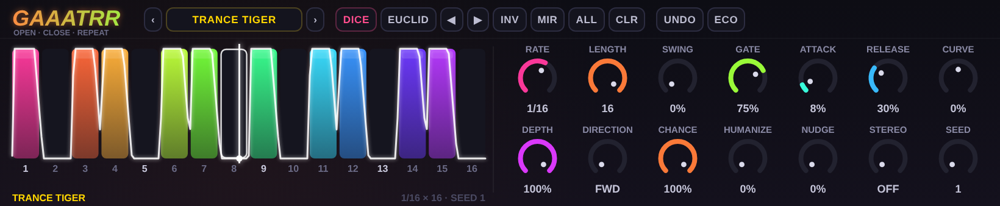
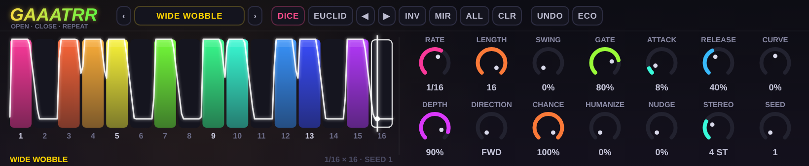

# GAAATRR 🚪

### *OPEN · CLOSE · REPEAT*

**A free trance-gate for Ableton Live.** Chop pads, chords, synths and whole mixes into rhythmic,
tempo-locked pulses, then bend the pattern with swing, curves, chance and a lot of dice.
A **Max for Live** audio effect by **Tom Lejeune**.




> **Status: v0.1, written but not yet run in Max.** The gate engine, the UI and the patch wiring are
> tested here (mock Max, headless browser), but nobody has loaded the device in Live yet. Start with the
> [first-run checklist](docs/PATCH.md#first-run-checklist) — it lists the handful of Max-specific things to
> verify.

---

## What it does

Gaaatrr multiplies your audio by a 16-step pattern that runs **locked to Live's transport**. Click steps on
and off, drag them to set their level, and shape every gate with attack, release and curve. It's the
classic trance-gate move, plus a pile of ways to keep it from sounding like a machine.



## The controls

| | | |
|---|---|---|
| **RATE** — step size, 1/2 down to 1/32T, with dotted and triplet | **LENGTH** — 1 to 16 steps | **SWING** — pushes every other step later |
| **GATE** — how long each step stays open | **ATTACK** — fade-in, as a share of a step | **RELEASE** — fade-out tail, can ring into the next step |
| **CURVE** — soft ↔ snappy envelope shape | **DEPTH** — how far the gate closes (100% = silence) | **DIRECTION** — forward, reverse, ping-pong, random |
| **CHANCE** — odds each step plays on a given pass | **HUMANIZE** — random per-hit level variation | **NUDGE** — slide the whole pattern later |
| **STEREO** — right channel runs N steps behind the left | **SEED** — which "random" you get; same seed, same groove | **OUT** — output level (Live's own fader) |

**Steps:** click to toggle, drag up and down to set the level, drag across to paint, mouse wheel for fine level.
**Knobs:** drag, `Shift` for fine, double-click to reset, wheel to nudge.

**Pattern tools:** 🎲 **DICE** (new random pattern and seed), **EUCLID** (evenly spread hits; each click adds one),
rotate ◀ ▶, **INV**ert, **MIR**ror, **ALL**, **CLR**, and **UNDO**. Sixteen **presets** to start from —
TRANCE TIGER, OFFBEAT PUMA, GALLOP GOBLIN, MACHINE GUN and friends.

**ECO** switches to lighter visuals (fewer frames, no glow) if you're short on CPU.

Every knob and every individual step is a Live parameter, so you can **automate** any of them (they show up
in the track's automation list), and it all saves with your Set.

## How it sounds right

The whole gate — every step, curve, swing and random roll — is rendered into one envelope table, and a
transport-locked phasor reads it. So it's sample-accurate, stays in time through tempo changes, and the
scope you see in the UI is *the actual curve being played*, not an approximation.

Chance, humanize, ping-pong and random direction are baked per pass from the seed across eight passes, so
the groove varies but repeats exactly, every time you press play.

## Install

1. Get the device: use the `device/` folder from this repo (or run `npm run build` to regenerate it).
2. Follow [docs/PATCH.md](docs/PATCH.md#putting-it-into-a-device) to drop it into a Max Audio Effect and save it
   as `Gaaatrr.amxd`. You need **Live 12** (it ships Max 9).
3. Put it on any track. Hit play.

Free to use, modify and share (MIT). If you make something with it, tell people!

## Build & test

```sh
npm run build      # regenerates device/ from src/
npm test           # DSP, engine (mock Max), patch wiring, and UI in headless Chromium
npm run screenshot # re-renders docs/*.png (needs Playwright)
```

No runtime dependencies. Node 20+. The UI tests are skipped if Playwright isn't installed.

```
src/core.js       the gate: envelope tables, patterns, presets   (pure logic, unit-tested)
src/engine.js     Max v8 glue: parameter hub, buffer writer
src/ui.html       the jweb interface (canvas, knobs, visuals)
scripts/          build, patch generator, screenshots
device/           what Max loads: gaaatrr.v8.js, gaaatrr-ui.html, Gaaatrr.maxpat   (generated)
test/             node:test suites
docs/PATCH.md     how the Max side is wired, and the first-run checklist
```

## Credits

Made by **Tom Lejeune**. Inspired by the long tradition of trance gates, and by
[Loooprr](https://github.com/tom-lejeune/loooprr)'s attitude: simple controls, strong opinions, big colours.
